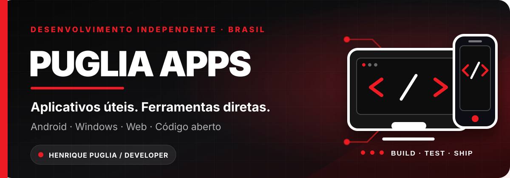
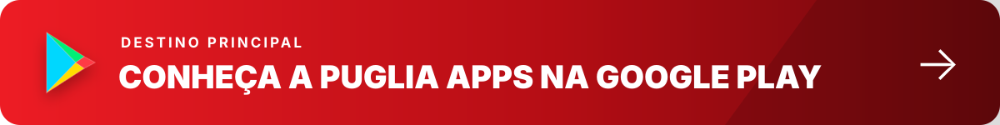
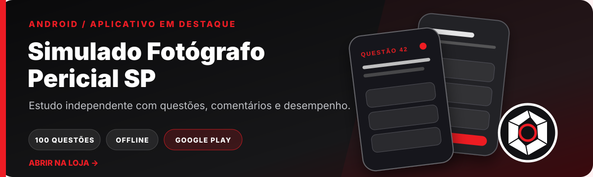
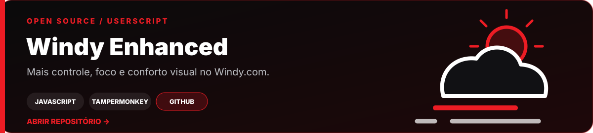
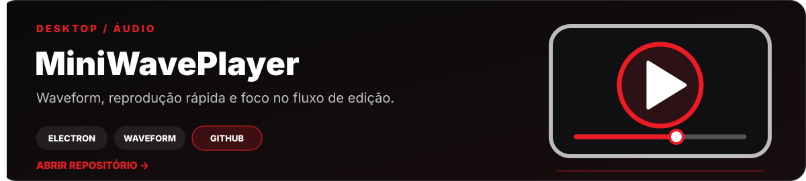
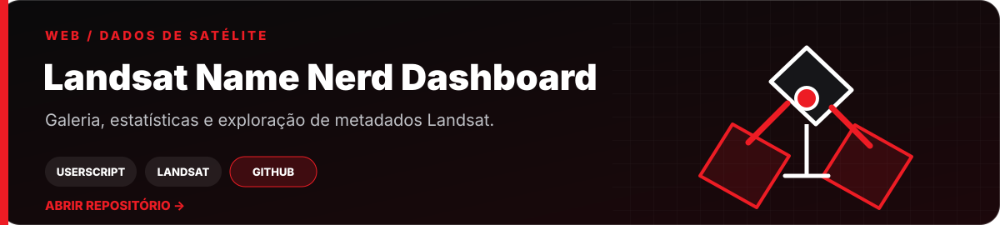

  

  

  
  

## Aplicativo em destaque

## Sobre a Puglia Apps

Sou **Henrique Puglia**, desenvolvedor independente no Brasil. Crio aplicativos e ferramentas diretas, acessíveis e focadas em resolver problemas reais — de estudo e produtividade a mídia, mapas e experiências para a web.

Este perfil funciona como a página principal da **Puglia Apps**. Para instalar os aplicativos, visite a Google Play. Para conhecer o código e os experimentos, explore os projetos públicos abaixo.

## Projetos públicos

  <a href="https://github.com/hpuglia?tab=repositories"><strong>Ver todos os repositórios públicos →</strong></a>

---

  <strong>PUGLIA APPS</strong> 
  Aplicativos úteis. Ferramentas diretas. Desenvolvimento independente.  
  <a href="https://play.google.com/store/apps/dev?id=6171605659077302644">Google Play</a>
  ·
  <a href="mailto:pugliaapps@gmail.com">Contato</a>
  ·
  <a href="https://github.com/hpuglia?tab=repositories">Código público</a>

